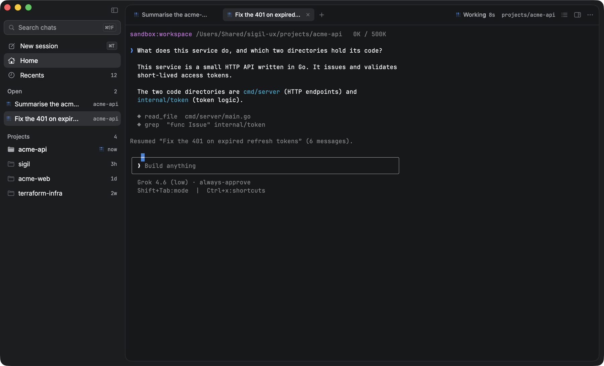

# Sigil


[](https://github.com/gl11tchy/sigil/actions/workflows/ci.yml)


A native macOS app around the `grok` command line tool. It runs the real Grok Build
terminal interface in a pseudo-terminal, so the tool behaves exactly as it does in a
terminal — and adds a window, tabs, and a searchable list of every conversation.

By gl11tchy.



*Demo data. The conversations shown are invented; the session on the right is real.*

## What it adds

- **Thread sidebar.** Every conversation on this machine. Home is the project
  list; open a folder to see its chats and start a new one with the plus. Recents
  and Archived sit under the folders as destinations you open. Search by title, folder or
  path. Click a chat to reopen it; if it is already open, the app moves to that
  tab. Hover archive on a chat or a project. Hover X closes an open tab, or
  deletes a closed chat. Workflow and subagent children stay off the list unless
  you turn them on in Settings. They still run in the background.
- **Search highlight.** Matches from the sidebar Search field (`⌘⇧F`) light up in
  each visible title, in the project name or path on the subtitle, and in the
  Projects header. A hit on the CLI summary or a path still paints a visible run.
- **Rename.** Name a conversation from the row's context menu, `F2` in the
  thread list, or `⌘⇧R` for the session on screen. The name is what the sidebar,
  tabs, and search use, and it survives the CLI rewriting its own summary.
  Reset Name, or a blank rename, brings that summary back.
- **Pins.** Hover a row and pin a chat. Pinned chats stay at the top of Recents
  and of an open project, in the order you pinned them. Hover a folder to pin
  it; pinned folders stay at the top of the project list.
- **Projects.** A list of working folders, newest folder first. Open a folder to
  see its chats. Pin a folder to keep it above the rest. The plus on a folder
  starts a session there.
- **Photo drop.** Drag an image onto the session, or paste one with ⌘V. Grok
  attaches it the same way it does in a regular terminal.
- **Tabs.** Several sessions at once, each in its own folder.
- **Right panel.** ⌥⌘B opens a second column beside the session. It holds a plain
  login shell in the same folder (⌥⌘1) and a notes pad kept per working folder
  (⌥⌘2). The shell is a scratch terminal only: no conversation, no tab messaging.
- **Status light.** A green dot per tab while the agent is working, and a dot on the
  Dock icon when a background tab finishes a turn.
- **Terminal colors and font size**, applied live; reopen a session to apply Grok’s interface theme.
- **Transcript export**, through `grok export`.
- **Delete**, from the row's hover X when the chat is not open, or from the
  context menu. The conversation folder goes to the Trash.
- **Tab restore.** The sessions you had open come back on the next launch. Starting the
  app never creates a new conversation.
- **Tab messaging.** Off by default. Turn it on in Settings, and each session gets four
  tools: `list_tabs`, `send_to_tab`, `ask_tab` and `reply_to`. A tab can hand work to
  another tab, or ask it a question and wait for the answer. See below.

## Phone remote control

Open **Settings → Remote** to connect a phone using a QR code. The hosted
companion is [https://remote.sigilapp.dev](https://remote.sigilapp.dev). The
included **Sidereal** PWA controls open sessions from any internet connection.
Deploy its small encrypted relay over HTTPS, then enter that address in Sigil.
The Mac makes outbound connections only; no router ports need opening.

See [Sidereal setup](Sidereal/README.md) for hosting, pairing, controls, and limits.
Remote access is off by default. Disconnecting or quitting Sigil revokes it.

## Tab messaging

Grok Build has no channel between sessions. Sigil supplies one: it owns every tab, so it
carries the messages itself.

Turning the switch on registers a `sigil` MCP server in `~/.grok/config.toml`, pointing at
a small helper inside the app bundle. Turning it off removes that entry again. Only
sessions started or restarted after you turn it on receive the tools.

A message is queued in the other tab, marked with the sending tab's name. The user can
deliver or dismiss it from the inbox banner. Sigil does not inject an incoming message
without the user's approval. An `ask` waits until the other tab calls
`reply_to`, or until the timeout runs out (5 minutes by default, 15 at most).

The socket lives at `~/Library/Application Support/Sigil/bridge.sock` and is readable only
by you. Any process running as you can talk to it, which is the same trust level as the
terminal itself.

## Keyboard

| Shortcut | Action |
| --- | --- |
| `⌘T` | New session in the current folder |
| `⌘⇧N` | New session in another folder |
| `⌘W` | Close tab (warns while the agent is working) |
| `⌘⇧]` / `⌘⇧[` | Next / previous tab |
| `⌘1`…`⌘9` | Go to tab |
| `⌘F` | Find in the terminal |
| `⌘⇧F` | Find conversations |
| `⌘B` | Hide or show the thread list |
| `⌥⌘B` | Hide or show the utility panel |
| `⌥⌘1` / `⌥⌘2` | Panel terminal / notes |
| `⌘+` / `⌘-` / `⌘0` | Font size |
| `⌘R` | Reload the conversation list |
| `⌘⇧R` | Rename the conversation on screen |
| `⌘,` | Settings |

In the thread list, `↑` and `↓` move the selection, `Return` opens it, and `F2` renames it.

## Requirements

- macOS 14 or later
- The `grok` CLI at `~/.grok/bin/grok` (set another path in Settings)
- Optional: `~/.grok/bin/grok-sigil`, the themed CLI build described below

The app is deliberately **not** sandboxed: it starts `grok` as a child process, and
that process needs the same access to your files and network that it has in a terminal.

## Build

```sh
Scripts/build-app.sh
```

This makes a release bundle containing both Apple silicon and Intel executables. It
refuses to package an old or single-architecture executable if that build fails. The
result is `dist/Sigil.app`.

Release builds need Apple's Metal Toolchain. Install it once if Xcode does not have it:

```sh
xcodebuild -downloadComponent MetalToolchain
```

For a faster local bundle on the current Mac:

```sh
SIGIL_CONFIG=debug Scripts/build-app.sh
```

To allow a current-architecture release bundle for local use only:

```sh
SIGIL_ALLOW_THIN=1 Scripts/build-app.sh
```

Local bundles use an ad-hoc signature. To keep macOS folder permissions across rebuilds,
set a signing identity:

```sh
SIGIL_CODESIGN_IDENTITY="Apple Development: Your Name (TEAMID)" Scripts/build-app.sh
```

### Signed and notarized distribution build

Store App Store Connect API credentials in Keychain once:

```sh
xcrun notarytool store-credentials "sigil-notary" \
  --key "/path/to/AuthKey_KEYID.p8" \
  --key-id "KEYID" \
  --issuer "ISSUER_UUID"
```

Then build, sign, submit, staple, and verify the app:

```sh
SIGIL_DISTRIBUTION=1 \
SIGIL_CODESIGN_IDENTITY="Developer ID Application: Your Name (TEAMID)" \
SIGIL_NOTARY_PROFILE="sigil-notary" \
SIGIL_VERSION="1.0.0" \
SIGIL_BUILD="1" \
Scripts/build-app.sh
```

The distribution command requires a verified universal build. It stops on signing,
notarization, stapling, or Gatekeeper errors. Notarization waits for 30 minutes by
default; set `SIGIL_NOTARY_TIMEOUT` to another duration such as `45m` if needed.

Install that bundle on this Mac (quits a running copy first):

```sh
Scripts/install.sh
```

That copies `dist/Sigil.app` to `/Applications/Sigil.app` and opens it. GitHub
cannot write to this Mac. After a merge to `main`, CI builds a zip and attaches
it to the rolling [latest release](https://github.com/gl11tchy/sigil/releases/latest).
Download that zip, or rebuild locally and run `Scripts/install.sh`.

Double-click the finished app, or run `open dist/Sigil.app`.

### Crash logs

If Sigil dies, it writes what it knew to `~/Library/Logs/Sigil/`: the open tabs,
the tail of the selected terminal, and the signal or exception that ended it.
Help ▸ Reveal Crash Logs opens the newest one in Finder. One report per run,
named in UTC so the folder always sorts by time, and ten are kept. A run that
never crashes leaves no file behind. Set `SIGIL_CRASH_LOG_DIR` to write them
somewhere else.

For where the app died, read the report macOS writes for the same crash under
`~/Library/Logs/DiagnosticReports`. Sigil's own report does not walk the stack:
doing that inside a signal handler can hang a process that would otherwise have
died and left that report behind.

Debug build that stays attached to the terminal:

```sh
Scripts/dev.sh
```

Regenerate the app icon:

```sh
Scripts/make-icon.sh
```

## The themed CLI

The detail column is a program someone else drew, so theming only the window
would leave two designs on screen. `Scripts/build-grok-cli.sh` builds the
open-source [Grok Build](https://github.com/xai-org/grok-build) CLI with one
patch on top — a `sigil-neon` TUI theme and a `GROK_THEME` override — and
installs it as `~/.grok/bin/grok-sigil`.

```sh
brew install protobuf   # once; the build also needs Rust
Scripts/build-grok-cli.sh
```

The app prefers `grok-sigil` when it is there and starts each tab with
`GROK_THEME` set to the window's theme. App palettes without a named CLI
theme send `sigil-host` plus `GROK_THEME_*` colour keys so the TUI matches
the window. Delete the binary and the app falls back to the installed
`grok`, which ignores those variables and runs as before.
The patches are `Scripts/grok-cli/sigil-neon.patch` and
`Scripts/grok-cli/sigil-host.patch`.

## Verify

```sh
Scripts/verify.sh
```

Requires Node 22 or later for the Sidereal tests.

Runs the build, native and Sidereal tests, dependency audit, shell checks, optional Swift format lint, debug app bundling, and
a launch smoke check. The smoke launch uses temporary home, preferences, cache, and Grok
folders. It does not restore tabs, register the bridge, or start a real session.

## License

MIT — see [LICENSE](LICENSE).

Sigil bundles [SwiftTerm](https://github.com/migueldeicaza/SwiftTerm) (MIT) and
[swift-argument-parser](https://github.com/apple/swift-argument-parser) (Apache 2.0).
Their license texts ship in `Sigil.app/Contents/Resources/ThirdPartyLicenses`. Sigil wraps
the Grok Build CLI but does not include it.

## Where the conversations come from

The sidebar reads `~/.grok/sessions/` (or `$GROK_HOME/sessions`), where the CLI keeps
one directory per working directory and one directory per conversation inside it. The
app watches that tree, so the list stays current while sessions run — including ones
started outside the app.

New sessions are started with an app-chosen `--session-id`, so a conversation is
traceable from the tab back to its directory on disk.
