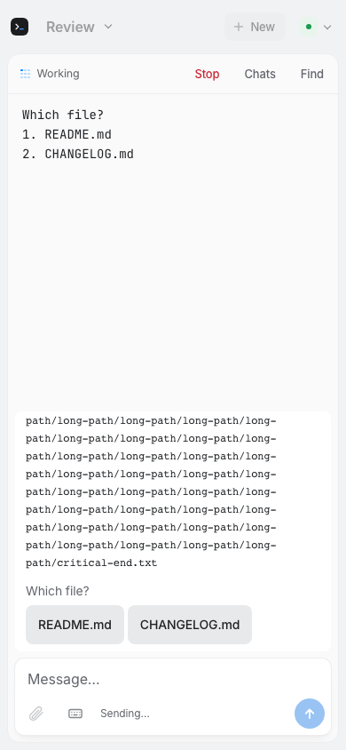

# Product hardening verification — 2026-09-27

This is local implementation evidence, not a production release or a claim of
flawless behavior. No personal sessions, model prompts, production deployment,
PR merge, or installed app replacement were used.

## Revision and environment

Work began at `be132383565d9d4cb4e253ae3f7f1b7183207c8f`. The branch
`codex/sigil-product-hardening` also contains the subsequent main revision
`a39d5baadb4d29f58023a78d73d4ef7d0bcee6bc` (PR #119) and
`92a352dde8587f6b93f14ec2fb6467883f940b26` (PR #120). Their sidebar/search,
asynchronous startup, native output/Find and screen-cache improvements were
preserved, not replaced. The existing native TextKit harness still runs alongside
the new shipping-app XCTest gate.
The final implementation revision is `98c1b527c5067fbed6bd45061e75b63f9342a3e6`;
the remaining delivery commit contains documentation and screenshot evidence only.
The Mac/web gate ran at `e5954f0`; its covered code is unchanged in `98c1b52`.

Local tools: Apple silicon, macOS 26.5.1, Xcode 26.6, Swift 6.3.3, Node 22.23.1,
Metal 32023.883 and iOS simulator 26.5. Provider contracts: Claude Code 2.1.283,
Codex 0.157.1 and Grok 1.0.40.

## Baseline

An isolated archive of `be13238`, with minimal Git metadata for revision-stamp
tests, passed `Scripts/verify.sh`: 807 Swift Testing cases, 37 XCTest cases,
158 Sidereal Node tests, 18 Site tests and 106 Chromium/WebKit browser cases.
Dependency audits, shell checks, formatting, debug packaging, signature checks
and isolated launch smoke also passed.

Baseline `iOS/scripts/relay-e2e.sh` passed 46 shared/relay cases.
`DERIVED_DATA=/tmp/sigil-native-baseline-derived iOS/scripts/build.sh` built
the actual unsigned simulator app and extensions. The old CI step covered only
selected sources compiled as a macOS executable, not that complete iPhone build.
GitHub baseline CI run `36319283213` was green on Xcode 16.4.

No failure in the existing baseline gates was confirmed. The first archive lacked Git metadata;
its revision-stamp failure was a harness error. During integration, old lifecycle
fixtures required explicit stop confirmation after initial state became unknown.
Old web fixtures required the new authenticated nonce. Those assertions were
updated to the new safety contract, not skipped.
The expanded native fixture reached the relay's 20-room/minute limit. Fixture
setup now retries only explicit HTTP 429 refusals within a bounded deadline.
Production limits and workflow assertions are unchanged; provider commands are
never retried by that fixture change.

## Final commands

The Mac/web gate and native gate are separate; neither substitutes for the other.

| Command | Verified result |
|---|---|
| `Scripts/verify.sh` | Passed: 888 Swift Testing cases, 37 XCTest cases, 161 Sidereal Node tests, 18 Site tests, 114 Chromium/WebKit cases; audits, shell/format checks, debug bundle/signature and isolated smoke passed |
| `iOS/scripts/ci.sh` | Passed: 85 shared/real-relay cases, 18 app-hosted simulator cases, 7 native TextKit cases, no skips |
| `Scripts/verify-provider-contracts.sh` | Installed version/help/resume contracts passed; no model calls |
| `xcrun --sdk macosx metal --version` | Metal compiler available |
| `shellcheck iOS/scripts/ci.sh iOS/scripts/native-test.sh iOS/scripts/native-output-test.sh iOS/scripts/relay-e2e.sh` | Passed |
| `git diff --check` | Passed |

The Mac gate includes real PTY dispatch through the loopback relay. The browser
gate runs both Chromium and WebKit against the real relay and encryption, with a
synthetic Mac endpoint. The native gate builds `Sigil.app`, `SigilNotifications.appex`
and `SigilWidgets.appex`, then runs the app on a fresh simulator through that relay.
The three-second launch smoke is only packaging/startup evidence.

See [native results and screenshot](ios-verification.md). The browser screenshot
shows the long operation scrolled to its exact ending and literal choices. Its
test also checks the unverified Terminal controls label and absence of invented Yes.

## Safety coverage and review

| Boundary | Regression evidence |
|---|---|
| Approval context and lifetime | `RemotePromptTests`, `RemoteInteractionTests`, `RemoteSessionOpsTests`: changed commands, changes past old display bounds, repeated/replaced prompts, duplicate/wrong-session answers, partial/wrapped menus and literal PTY bytes |
| No false completion | `TerminalTabTests`, `ProviderLifecycleJournalTests`: silence/title never complete; matched native turn events, duplicates, delayed writes, missing files, replaced/truncated/same-inode rewritten files, crashes and real subprocess journal writes |
| Native continuity | `NativeSessionScannerTests`, `ProviderContinuityIntegrationTests`, `NativeStartupRestorationTests`, `NativeHistoryVisibilityTests`: separate native identities, missing projects, deferred restore, unknown formats, mixed metadata, image-only history and no replacement session |
| Notes and capabilities | `ConversationNotesStoreTests`, `ProviderAdapterTests`, `ProviderBoundaryTests`: provider isolation, traversal rejection, supported controls only and unchanged Grok paths |
| Remote freshness and routing | `RemoteRelayTests`, `RemoteStreamOrderingTests`, browser/native tests: client nonce, replayed hello/replies/events, re-watch ordering, revocation during notification registration and no stale socket work |
| Upload and lost-response safety | `RemoteUploadTests`, web tests and native flow tests: connection/tab-bound transfers, orphan/duplicate tails, bounded online queues, no blind retry, same-socket epoch changes and ambiguous timeouts |
| Draft/data preservation | Web and `NativeFlowTests`: exact restart identity, capped snapshots, two Macs sharing a tab ID, delayed authorization/ticket writes/Enter acknowledgements, live state before disk cache, events before restart receipts and retired attachment aliases |
| Notifications | `RemoteAlertTests`, native protocol/receipt tests: finished/failed/stopped/attention distinction, unverified hints, fresh alert IDs, duplicate/expired rejection and bounded receipt storage |
| Phone usability | Chromium/WebKit layout/scroll/focus/raw-output tests; native accessibility-size composer/focus and keyboard-layout-guide test |

New regressions were observed failing before repair for approval aliasing and
fabricated choices, duplicate/orphan uploads, same-socket web authorization,
timeout queue continuation, native authorization epoch reuse, and cross-Mac
draft deletion after delayed Enter. Additional regression fixtures exercise the
remaining boundaries above. Not every security invariant was independently
backported to the baseline.

Independent reviewers checked each workstream outside their own implementation.
They found and repaired startup restoration races, native notes isolation,
titleless native-history visibility, raw-key paste semantics, stream ordering,
revocation persistence, capped restart receipts, malformed-reply continuations,
authorization epochs, cross-Mac draft mutation and project-archive capability
boundaries. Confirmed archive operations leave unsupported running tabs alone.
Post-PR #120 review also repaired asynchronous-cache identity loss, restart events
arriving before their receipts, draft overwrite and retired attachment resurrection.
Documentation was checked
against the implemented capability limits. No reported code finding remains open.

## Performance

These are local synthetic fixtures, not field telemetry or cloud capacity claims.

`NativeSessionScannerTests` scanned 900 native conversations with 20 response records each,
plus header and user records:
cold 286 ms, cached 49 ms, and title/path search 9 ms in the focused run.
`HistoryResponsivenessTests` loaded 900 Grok histories beside four live isolated
PTYs: scan 94 ms; 100 searches 922 ms total (12.3 ms maximum single search);
20 sidebar snapshots 158 ms total (10.4 ms maximum single snapshot).
The main-actor 5 ms ticker's longest interval was 29.6 ms. Test-process RSS was
79.7 MiB; that is not standalone app memory or a long-duration leak measurement.

The final integrated Mac suite, alongside native verification, repeated that
fixture: scan 183.2 ms; 100 searches 1,211.8 ms (19.8 ms maximum); 20 snapshots
351.8 ms (24.5 ms maximum); longest ticker interval 37.9 ms; test-process RSS
112.4 MiB after earlier suites. Native-history scan repeated at 246.9 ms cold,
43.1 ms cached and 8.8 ms search. These
two runs show local variation, not a statistical latency percentile.

The original harness ran all 120 UI operations without yielding and recorded a
964 ms synthetic actor stall. The corrected harness yields between separate user
actions and reports per-action cost; it did not hide or optimize production work.
The measured individual actions did not justify another index or database.

An earlier unthrottled native pairing/selection/send/terminal-control/reconnect/error
test took 3.9 seconds. In the expanded final suite, that case took 67.1 seconds,
including fixture room-allocation rate backoff; the separate connection-level
pair/input/reconnect/error case took 3.7 seconds. Reconnect did not resend input
and retained only identity-matched drafts. These are combined fixture journey
times, not isolated reconnect latency percentiles. WAN, cellular and large
streaming workloads remain unmeasured.

## Remaining verification boundaries

- **CI runner prerequisite:** the configured `sigil-vm` image is Xcode 16.4.
  The complete iOS 26 gate requires Xcode 26+ and an installed iOS 26+ simulator.
  The old green workflow did not establish that capability. The new gate fails
  explicitly instead of skipping the shipping targets. External runner changes
  and paid hosted capacity were not part of this task.
- **Provider limits:** all parsed approvals remain unverified terminal controls.
  Claude has no integrated final-completion observer. A new Codex tab cannot
  acquire a native ID by guesswork; open its discovered history to resume it.
  See [exact capabilities](../../provider-capabilities.md).
- **Credentials/hardware:** authenticated provider turns and expired-account
  recovery, physical APNs/Live Activities, camera/cellular workflows and device
  entitlements were not exercised. Local tests use deterministic supported fixtures.
- **Distribution:** debug Mac bundles are ad-hoc signed. Simulator artifacts are
  unsigned. No signed/notarized release or production protocol upgrade was made.
  Mac and phone clients must be released together for the nonce requirement.

Local raw gate logs are in `/tmp/sigil-hardening-evidence/`; native result bundles
are under `.build/native-verification/`. These transient artifacts are not committed.
Committed fixtures, commands and screenshots make the checks reproducible.
