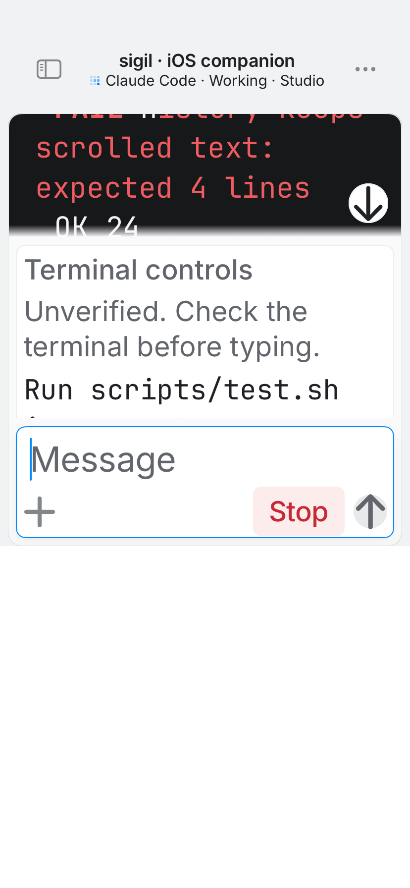

# Native iPhone verification

Verified locally on 2026-09-27 with Xcode 26.6 and the iOS 26.5 simulator runtime.
The tested shipping source is commit `98c1b52`, after PR120 integration and the final cache/restart repairs.

## Commands and results

- `iOS/scripts/relay-e2e.sh` baseline: 46 passed.
- `DERIVED_DATA=/tmp/sigil-native-baseline-derived iOS/scripts/build.sh` baseline: the complete unsigned simulator app built.
- `iOS/scripts/ci.sh` after integrating PR120 and the final race repairs: Xcode preflight, typecheck, 85 shared-logic/real-relay tests, 18 app-hosted simulator tests, and 7 native TextKit tests passed. No native tests were skipped.
- `shellcheck iOS/scripts/ci.sh iOS/scripts/native-test.sh iOS/scripts/native-output-test.sh iOS/scripts/relay-e2e.sh` and `plutil -lint iOS/Sigil.xcodeproj/project.pbxproj` passed.

The final repeated local result bundle is `.build/native-verification/native-20260927-121152-67346.xcresult`.
The full repeated gate log is `/tmp/sigil-hardening-evidence/native-pr-review-ci.log`. Its 85/18/7 checks passed on unchanged native source while the Mac watcher review was addressed. These results supersede the pre-PR120 57 shared/relay and 15 app-hosted counts.
CI uploads its own result bundles as `iPhone-native-verification` artifacts.

The native gate discovers an installed compatible simulator runtime, creates a fresh simulator, and removes it after testing. It builds the actual `Sigil` scheme and checks these embedded executables:

- `Sigil.app/Sigil`
- `Sigil.app/PlugIns/SigilNotifications.appex/SigilNotifications`
- `Sigil.app/PlugIns/SigilWidgets.appex/SigilWidgets`

The tests use the real relay, encryption, native connection, and app store. The Mac endpoint is a deterministic protocol fixture, not a paid provider session. Coverage includes pairing, two Macs with identical tab IDs, session selection, text and terminal keys, unverified choices, reconnect without retry, malformed replies, old-handshake replay, event replay, connection changes during input, draft identity, and notification freshness/receipt bounds. A held disk-cache test proves that exact native identity preserves a returning Mac's draft and attachments before its cache arrives, while stale cached output cannot replace live output.

Restart regressions reproduce and fix complete and capped replacement events arriving before their receipt. Distinct edits and attachment IDs survive, retired files cannot reappear, and mismatched or same-ID receipts do not destroy unsent work. The dispatch is bound to its Mac, connection epoch, and original native identity.

PR120's off-main output, cache, Find, scrolling, and cover tests remain intact. The standalone TextKit harness runs separately from the shipping app's XCTest bundle, avoiding competing app entry points. Native fixture setup respects the relay's real 20-room-per-minute limit: only an explicit HTTP 429 room-allocation refusal can be retried, within a 75-second setup deadline. Protocol workflow waits and command no-retry rules are unchanged.

The screenshot contains synthetic demo data. An app-hosted test focuses the editable composer at accessibility text size and checks that its frame stays above the keyboard layout guide. The image captures the app window, not the system keyboard window.

## CI prerequisite and limits

The configured `sigil-vm` runner image is currently `macos-sequoia-xcode16.4`. It cannot build this iOS 26 application. The native gate now fails clearly on that toolchain rather than treating shared macOS tests as an iPhone build. An Xcode 26+ runner image with an iOS 26+ simulator runtime is still required. This task did not alter the external runner or buy hosted-runner capacity.

Local simulator evidence does not prove signing, physical-device Keychain entitlements, APNs delivery, notification extension activation, or remote Live Activity updates. It does not prove signed or notarized distribution artifacts.

Notification UUIDs and timestamps are verified before display. A bounded file-locked receipt ledger in the extension's private container prevents a second authenticated delivery of the same alert. APNs can still display the extension's passive, local fallback banner for an invalid or duplicate notification; the extension cannot cancel an already delivered APNs notification. That fallback contains no session action, copied alert text, or completion claim.
