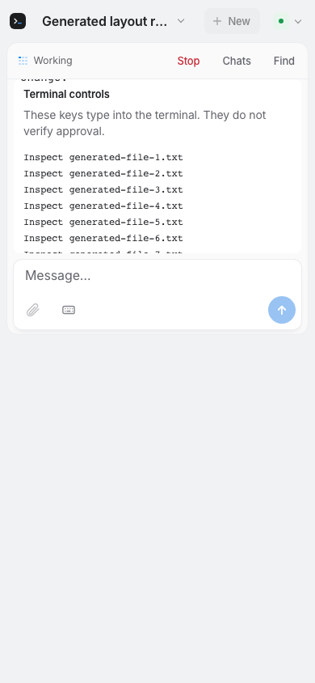
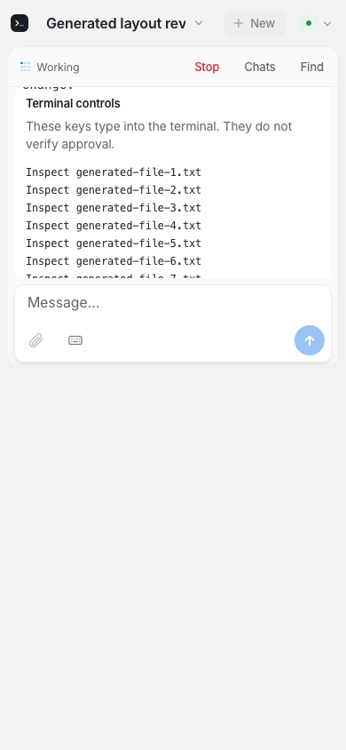

# REA-1192: output alongside terminal controls with the keyboard open

Base: `f4aa59d0dfd980e14b5c6fcc3fad17d05b3d6ec2`.

## Observed baseline

[CI684](https://github.com/gl11tchy/sigil/actions/runs/40177548688) ran test-only
head `8493914881e26044af04568c2cfba70a3dcfa07d`, with production unchanged.
Actual logged checkout `f3542fcc6050a443adbd33390243ed7fdce7b021` has verified
base/head parents and identical tree `175fb769c5c758c9a0e3a5330fb51efb7c830bbe`.

The new tests hold the layout viewport at 390×844 and send the actual app's
visualViewport resize handler a 420px height. Generated encrypted Mac state
contains a 25-line operation, truthful unverified terminal controls and three
literal choices. In both Chromium and WebKit, with keys closed or open:

- Output height was **0px**. The terminal's padding still occupied 48px, placing
  its bottom at 146px over the card beginning at 98px.
- With keys closed, the card occupied 215px, exceeding the visual cap 126px.
- With keys open, keys occupied 126px and the card 81px; output still collapsed.
- Header 52px, workspace bar 45px and composer 92px (226px with keys) exhausted
  the flex budget. Send stayed within the page; no command was dispatched.

Browser result: **260 passed, four new failures, two existing skips**. Verify
stopped there; Swift/native/release gates did not run. The CI watcher and artifact
reads exited. The original PNGs below were visually inspected and copied without
pixel changes. This is generated browser emulation, not physical Safari or an
unseen customer-impact claim.

SHA256: `fe1a0672acfaeedce9ec492ea240502de376ce90d1161e66ac789d872d82530f`.

SHA256: `b2ece9a3c618d41ffbff20be55b868a0ef5319e95a75860b07ed43fa17d0d5e3`.

## Implementation checkpoint

The card cap now uses the visual viewport. A visible card reserves a 100–120px
output area. Compact card layouts keep one scrollable 44px key row; a card keeps
space for one 44px choice plus padding. The controls region scrolls as a whole
when a very short page cannot fit all mandatory regions. No-prompt layout rules,
tokens, type, labels, commands, identity and remote security remain unchanged.

The original failing assertions remain, with added output-visibility checks.
Additional cases cover the full-height 30% cap, natural short-operation height,
and 200px visual heights with keys open/closed. They verify output and input
reachability through real scrolling, all choice actionability and no dispatch.
**Implementation runtime results and changed screenshots remain pending CI.**

## Limits and validation route

The attempted local baseline stopped before any browser/test assertion because
the sandbox refused the fixture relay's `listen(0.0.0.0:3099)` with EPERM. No local
layout result is claimed. That route was not retried/escalated, and no browser/OS
permission was requested. Existing CI is the independent supported runtime route.
Syntax, whitespace, original progress-prefix and source-scope checks run locally.

Physical iPhone Safari and its actual software keyboard remain unverified.
No local native build/tests/process enumeration, real sessions/credentials,
installed-app interaction, relay deployment, separate distribution or extra
worker. Installed420 and held PR162/183/191/192 remain untouched. Parent personal
review of exact final source/current comments and required exact-head CI precede
merge. Baseline failures are intentional; CI failure repair count remains zero.
