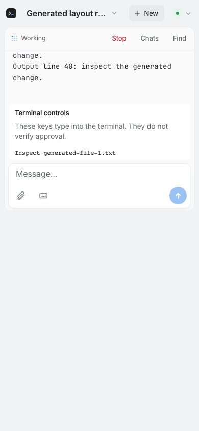
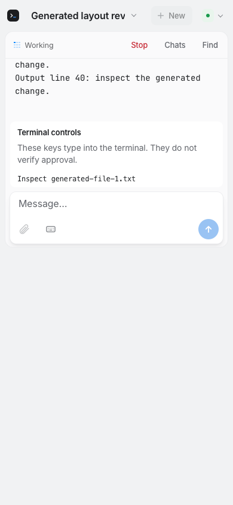
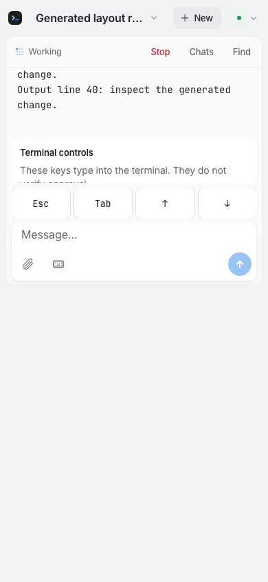
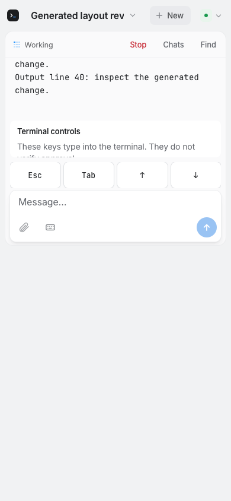

# REA-1192: output beside terminal controls with the keyboard open

Base: `f4aa59d0dfd980e14b5c6fcc3fad17d05b3d6ec2`.

## Observed baseline

[CI684](https://github.com/gl11tchy/sigil/actions/runs/40177548688) tested
`8493914881e26044af04568c2cfba70a3dcfa07d`, with production unchanged.
Logged checkout `f3542fcc6050a443adbd33390243ed7fdce7b021` has verified
base/head parents and identical tree `175fb769c5c758c9a0e3a5330fb51efb7c830bbe`.
The generated encrypted fixture has a 25-line operation and three literal,
unverified terminal choices. Layout stays 390×844; the actual app's visualViewport
resize handler receives 420px. Both engines measured 0px output, with 48px terminal
padding over the card. The closed-keys card was 215px, above the 126px visual cap.
With keys open, keys used 126px and the card 81px; output still collapsed.

**260 existing browser cases passed, four new cases failed, two existing cases
skipped.** Verify stopped there; Swift/native/release stages did not run. This
is reproduced generated browser behavior, not an unseen customer-impact claim.

## Implementation and observed validation

The only production change is CSS. A visible card reserves 100–120px for output
and uses the visual viewport for its 30% cap. Compact card layouts keep one
scrollable 44px key row. A card retains space for one 44px choice plus padding;
the controls region scrolls when a tiny page cannot fit all mandatory regions.
No-prompt layout rules, design tokens, labels, commands, protocol, identities,
cryptography and native app source are unchanged.

[CI685](https://github.com/gl11tchy/sigil/actions/runs/40178644833) passed at
implementation `4328be55977e55e7f3c8ae572cbd8a28e054873f`.
Actual checkout `9ffe512f3aff2cb5616d34250d6d8b673f6c5cca` has verified
base/head parents and identical tree `ead9266fa329d27e1188b3d328af0aa5acad51b2`.
The full gate passed: 270 browser cases plus two existing skips; 1,372 Swift tests
in 114 suites; 37 Mac XCTest cases; 318 Node tests; 58 Site tests; 32-file iPhone
typecheck; 88 real-relay harness checks; native app/shipping extensions; seven
TextKit checks. Sidebar fixtures: two passed, four existing REA-1350 pointer
fixtures skipped for unavailable event-posting permission. No independent
native-result artifact decoding was needed for this CSS-only ticket.

Actual Chromium and WebKit geometry was identical:

| Case | Output | Card | Send bottom |
| --- | ---: | ---: | ---: |
|420px visual height, keys closed |105px |110px |405px |
|420px visual height, keys open |105px |62px |405px |
|844px keyboard-down, long operation | readable |253.1875px | within page |
|844px keyboard-down, short operation | readable |244px | within page |

At 200px visual height in 390×844 layout, output was 100px and all choices were
reachable. The composer was separately reachable via controls scrolling; Send
bottom was 185px, with scrollTop 177px/225px for keys closed/open. Original failing
assertions remain, now strengthened with visible output bounds. Generated fixture
errors/page errors stayed absent and trial clicks dispatched no terminal input.

## Original screenshots

All six PNGs below are original 390×844 CI captures, visually inspected and copied
byte-for-byte; no pixels changed. Blank space below the simulated visual viewport
is the browser layout viewport, not a rendered physical keyboard.

| Chromium | WebKit |
| --- | --- |
| | |
| | |
| | |

Before hashes:

- Chromium: `fe1a0672acfaeedce9ec492ea240502de376ce90d1161e66ac789d872d82530f`.
- WebKit: `b2ece9a3c618d41ffbff20be55b868a0ef5319e95a75860b07ed43fa17d0d5e3`.

After hashes (source CI685):

- Chromium: `b47d6b77fa1f23a37dc428b680524ed00562471c59a3d6e9c12e61f27206f001`.
- WebKit: `48a47be203495ee272f6fd0103578d8287fc5197089e39192865f93f2aad222c`.
- Keys Chromium: `45339e9ce238c8b225fac0f9f52d043a69691c7a6ef279c63be98de5e265e000`.
- Keys WebKit: `7d6e9559ae17a5e012df4093297979f902295a7170fb7df79202071a4461d285`.

## Final coverage and limits

After CI685, the tiny-height cases were also parameterized at 844×390 landscape
layout, retaining 390×844 portrait coverage. Both first and last key rows receive
trial actionability checks, and an original output-stage tiny screenshot is kept
as well as its input-stage capture. This evidence commit therefore changes test
coverage and is not docs-only. Production CSS is byte-identical to CI685. Assess
the expanded landscape coverage using final-head checks; CI685 proves only the
initial portrait tiny-height cases. Parent personal review and passing required
exact-final-head CI must precede merge.

Physical iPhone Safari and its actual keyboard remain unverified. The local
baseline attempt stopped before any browser/assertion because the sandbox refused
fixture relay `listen(0.0.0.0:3099)` with EPERM. It was not retried/escalated; no
browser/OS permission was requested. Existing CI is the independent runtime route.
Local syntax/whitespace, original progress-prefix, source-scope and PNG-byte checks
pass. No local native build/tests/process enumeration, personal/provider data,
real credentials/access changes, installed build 420 interaction, deployment/distribution
or extra worker. Held PR162/183/191/192 stay untouched. No CI failure repair round
was needed; baseline failures were intentional.
