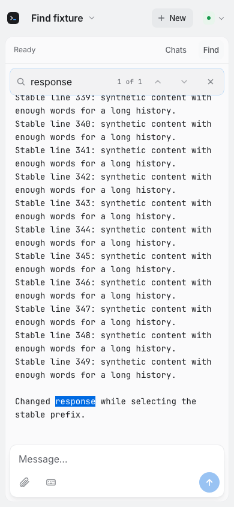
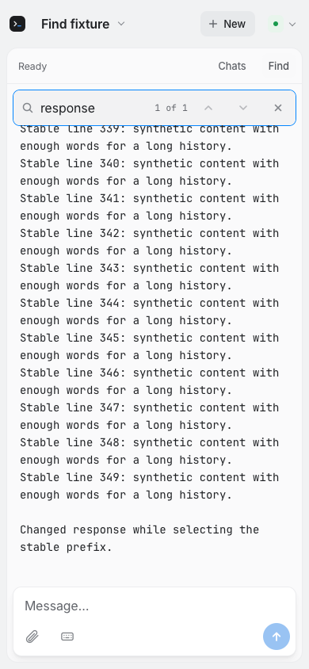

# REA-1194: incremental web output

[Ticket](https://linear.app/reasonable-glyph/issue/REA-1194/stop-repainting-the-whole-web-output-on-every-changed-poll).
Base `2d347ac899be1b2ffee0d332abb9e11c32061a6a`; sole isolated worker.

The unchanged renderer reformatted all cached history and replaced all terminal
nodes on each changed poll. Generated encrypted loopback data reproduced this
cost without provider calls or personal history.

| Direct render duration | Before | Final local source |
|---|---:|---:|
| Median | 70.95 ms | 7.35 ms |
| p95 | 72.90 ms | 9.10 ms |
| Maximum | 75.20 ms | 9.10 ms |

Both measurements: isolated headless Chromium, 390×844, CDP CPU rate 4;
404,620 raw / 381,981 formatted characters; 33 earlier slices of 11,900 ASCII
bytes and one similarly sized tail, all through the real relay and encryption.
Five changed-poll warmups followed by 20 measured polls, changing the tail's
response counter once per ordinary poll. `performance.now()` wraps the actual
`renderOutput` region in a test-only served-source wrapper: formatter, DOM/Find
updates and synchronous scroll/layout reads. Decryption/network wait/history
merging and later raster work are outside this region. Median is the mean of
the middle pair; p95 is nearest rank 19/20. Every sample is attached as JSON by
the test. The Chromium p95 guard is 25 ms; the observed maximum also meets it.
This is synthetic evidence on this Mac, not a field/customer latency claim.
[All samples and environment](rea-1194-timings.json): Node26.4.0, Playwright1.63.0,
Chromium153.0.8010.12, WebKit26.6, arm64 host.

The reader verifies the entire shared raw prefix, reuses cached raw lines and
resumes the exact checkpoint before a changed line. Checkpoints retain blank
compression, bubble continuation and the last output line that reflow may edit.
Trailing composer detection still reads the cached sequence; if its boundary
moves backwards, replay starts at the exact earlier checkpoint. A reflowing
paragraph retains its start and two recent mutable states, avoiding retention of
every growing paragraph version. Older edits replay from a surviving checkpoint;
changed-session/prepend formatting resets, as do pairing resets. Exact same
source text can reuse its already formatted result through raw/layout toggles. There is no fixed
overlap or assumption that an arbitrary newline resets formatter state.

DOM updates retain verified prefix blocks and nodes, rebuilding from a whole-line
block that includes the preceding chunk of the first difference. That covers
newline/word/grapheme boundary changes. Existing marks are restored before suffix
replacement and recomputed by the existing Find path. Unexpected prefix DOM,
prepends/trims or early edits conservatively rebuild; a very long changed block
may require more work. No universal 25 ms guarantee for arbitrary text is claimed.

The full `readableOutput` implementation remains unchanged as the oracle. All
existing expected-output fixtures also assert incremental equivalence. Added
character/line edits, composers, clocks, padding, Unicode, 400KB bounded tail
work, 1,200 deterministic rewrites and long-paragraph retention/replay tests pass:
33 focused Node tests. The required local web-find/mobile regression passed
216 tests with two skips (existing Chromium-only-inapplicable Hindi case and new
WebKit-inapplicable CDP probe). Four new behavior cases pass in both engines,
with/without CSS Highlights: retained nodes, changed-tail Find, repeated match
navigation, raw/copy text and selection. Existing prepend/trim/scroll/session
navigation and Unicode suites remain intact. Final new-case focus passed five tests with one skip after the retention guard;
a further four screenshot-range checks passed. Exact-head CI results are recorded
in the PR after observation.

Final-source 390×844 screenshots:

Two baseline setup failures were preserved and corrected before production edits:
a nonexistent earlier-output button (use scroll-to-top), and Unicode fixture
characters exceeding the 12KB frame byte limit. The successful fixture has an
explicit byte guard. No assertions or existing deadlines were loosened.

No redesign or related composer changes, paid/provider calls, personal data,
local Mac AppTests/build, process enumeration, deployment or app update. Protected
PR162 and all thirteen earlier manual-review records remain preserved. A Linear
evidence-comment creation was blocked; no comment was created and it was not
retried. Evidence remains in these files and the normal PR. Parent personal
final-code/exact-head CI review is required before merge.

Initial candidate CI38455449475 stopped in Node tests:129 passes/79 failures
because two VM harnesses stripped imports but injected only the previous formatter.
The real browser module imports had passed locally. Repair binds the actual new
reader factory/prefix function and retains the formatter-call counter. That
revealed one existing no-reformat assertion: raw toggles pass a layout-reset flag.
A one-line production correction restores same-source formatted reuse. All208
Node tests then passed, and final new-browser focus passed five tests/one skip.
No old assertions or deadlines were weakened. Browser/Swift/native integrated
checks were skipped in the initial failed gate; repaired exact-head gate pending.
