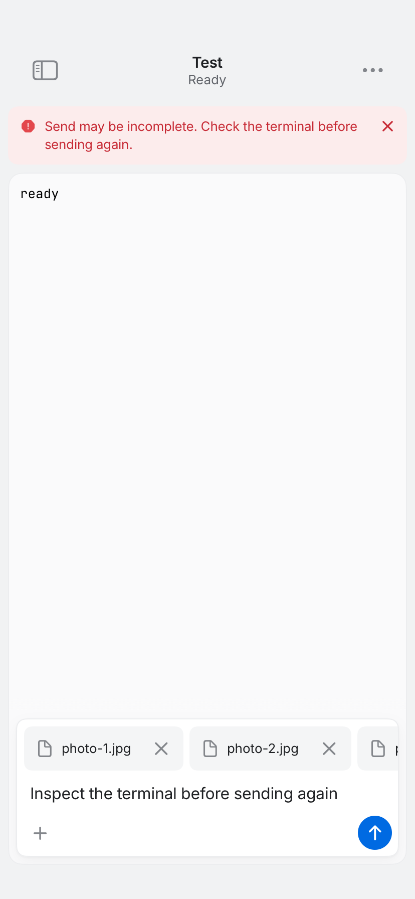
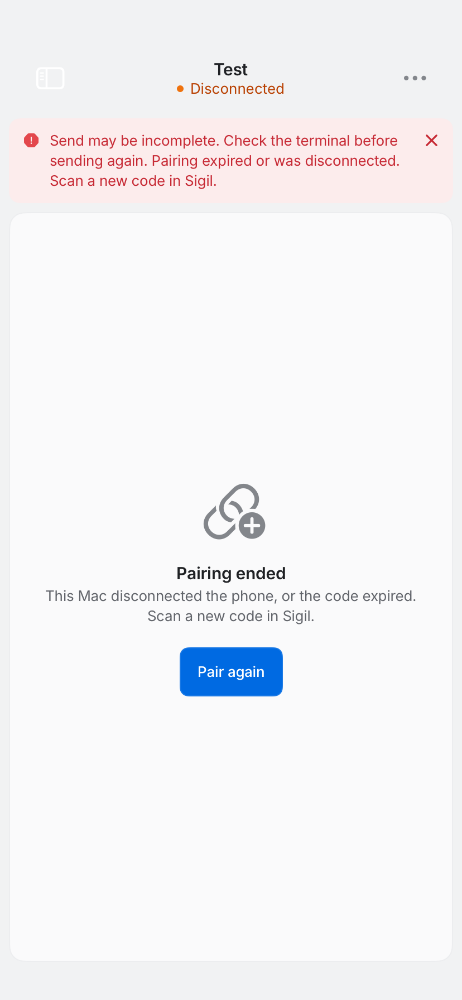

# REA-1198: finish an owned send before background closure

Base: cccbe4c08d902b9f07019ea32430d6caa701abb1.

## Reproduction before production edits

[Baseline CI 39090877227](https://github.com/gl11tchy-team/sigil/actions/runs/39090877227)
ran test-only head 8c48184a0bc301361313b2d577405eb3611e2714. Actual checkout
9ee741bd450c983b812bc0cc9cfb368ef8310736 has the expected base/head parents and
the identical head tree. All production source was byte-identical to main.

The generated three-photo case backgrounds immediately after Send. Its result
bundle records no file, input or Enter frames, the draft still containing
“Three synthetic photos”, retained attachments and an already closed connection.
Eight assertions failed in that one regression. General Verify, the 32-file
iPhone typecheck and shared relay tests passed.

The result bundle also records an existing test failing to allocate a relay room.
Disconnected fixture rooms retain the production five-minute grace; the suite
crossed the unchanged per-source 20-room cap, which a 75-second retry cannot clear.
Native cases now rotate over eight fresh loopback relay instances in one owned
Node process, with each serial case pinned to one instance. Production relay source,
limits, grace periods, command deadlines and the 120-second native case allowance
remain unchanged.

## Resulting behavior

- An owned send reserves a named UIKit background task before starting network
  work. The app's background lifecycle opts into waiting for that send; the
  default teardown path still stops immediately.
- Files and acknowledged attachments keep their existing ordering, followed by
  input and Enter. A completed send closes its background socket and ends its
  assertion. With no send, closure remains immediate.
- Denial, expiration or a lost reply retains an explicit possibly incomplete
  outcome. Known acknowledged attachments are not uploaded again. Pending work
  remains available for inspection; no command is automatically retried. Error
  presentation preserves that outcome when automatic reads report another error.
- Foreground return keeps a still-active send and socket, replaces its background
  assertion, and invalidates the old expiration callback. Task, Mac, connection
  epoch, assertion and draft revision identities fence stale continuations.
- A background disconnect cannot schedule reconnect after the store stops it.
  Revocation remains revoked; its screen also keeps the incomplete-send warning.
- The request queue, wire fields, cryptography, ten-second command deadline and
  REA-1199 terminal-key controls remain unchanged.

Apple recommends requesting the assertion before the work starts and requires
balancing every granted task. The allowance is finite and may be refused.
[UIKit background task contract](https://developer.apple.com/documentation/uikit/uiapplication/beginbackgroundtask(withname:expirationhandler:)).

## Validation

Native execution is CI-only. First implementation candidate
e428ab5fe19b183f6a144d5868eef3c1ae60edc8 passed
[CI 39092981215](https://github.com/gl11tchy-team/sigil/actions/runs/39092981215):
all 33 NativeFlow cases, including the 15 new cases. The full general/native gate
passed as well. Actual checkout 2c2b9613acea7ec57df2417272a0079fabfcf129 has the
expected parents and identical candidate tree.

Visual review of its two 828×1792 PNGs rejected the expiry capture: an automatic
read replaced the warning after the model assertion. Revocation displayed the
warning correctly. The repair composes uncertainty centrally for every error
writer, models supported legacy options and empty earlier-history replies, and
asserts the warning after UI layout. The lost-reply case also covers both input
and final Enter acknowledgement loss, followed by a real failed options read.

Repair head f4f88a9e589998a63b22c580213e844468d1b014 passed
[CI 39094902441](https://github.com/gl11tchy-team/sigil/actions/runs/39094902441).
Actual checkout 15fcd7fde2dc1176efc1ddc4d82a2df5b20f4426 has the expected
base/head parents and identical tree 413399215d6038630a08df00a24449c26b33b236.
The generated result bundle records all 33 NativeFlow cases successful, including
all 15 new cases and both lost-reply scenarios. No test failures were recorded.

The full gate also passed: 1,342 Swift tests in 113 suites, 37 Mac XCTest cases,
271 relay/client Node tests, 58 site tests, 244 browser cases, the 32-file iPhone
typecheck, shared relay tests, app and both shipping extension builds, and seven
native TextKit/Find/cover cases. Two existing browser cases were skipped. Four
existing REA-1350 pointer fixtures were skipped because CI lacks event-posting
permission; their separate owner-approved manual verification remains pending.

## Inspected simulator captures

Both original 828×1792 PNG attachments came from the repair run's generated
NativeFlow result bundle. They were exported without pixel changes and visually
inspected. The earlier incorrect expiry capture is excluded. The final evidence
commit changes only these images and QA/progress documentation; required CI must
also pass on that final head before merge.

Expired budget: the full warning, retained draft and photo chips remain visible.
The horizontal attachment strip clips the third chip until scrolled.

SHA-256: 6c702cd940789d15516c5e176a1cb9a1bb8f3931e42246e08066bc3907d6e48e.

Revoked pairing: the full warning remains visible beside the Pairing ended state.

SHA-256: 0b0fb46eb13e9c13218ce2c52a7c16eec3cf056dc20dd9ca43a642260f7e1861.

Static shell, embedded Python/Node syntax, whitespace and source-scope checks are
recorded separately. No local Swift build, formatter, native test or app launch
has been performed.

The fixture uses the real relay, encryption and app connection with generated
Mac/pairing data and an injected background budget. Boundary callbacks are
controlled explicitly; the busy-ownership case intentionally delivers store
lifecycle callbacks at an acknowledgement boundary while the transport stays
valid to test ownership independently of the wire epoch.

Physical-device suspension, actual OS allowance duration, network handoff,
distribution signing, APNs and production deployment are unverified. A successful
dispatch acknowledgement does not prove provider acceptance or completion.
The parent's personal review of exact final code and current comments, plus
passing required final-head CI, must precede merge.
