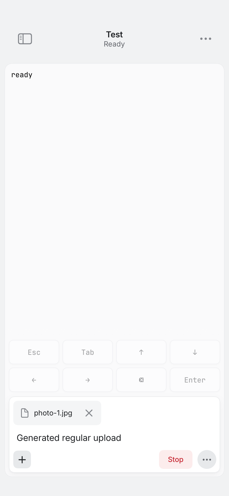
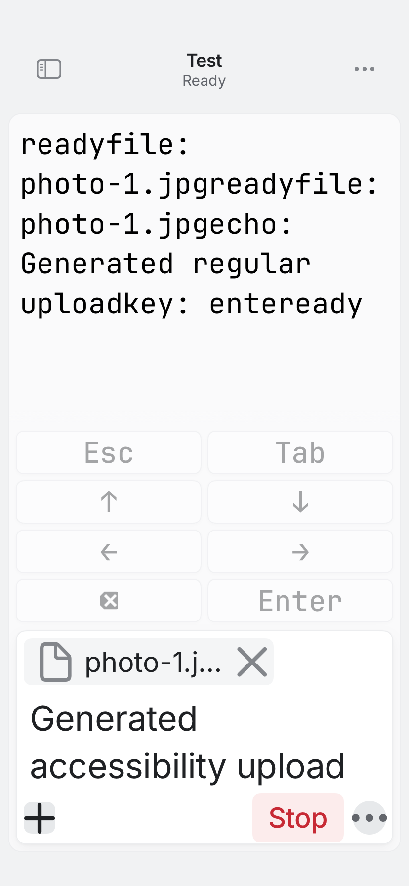

# REA-1199: busy terminal keys and interrupted input

Base: c760d2d45a603b61d2956c255afb63e47c7dc206.

## Reproduction before production edits

[Baseline CI 39100616743](https://github.com/gl11tchy-team/sigil/actions/runs/39100616743)
ran test-only head d2941ee76c66dfed912695e637a648284fed8051. Actual checkout
1f36bee59f321814b08e13c24356ec19400bd418 has the expected base/head parents and
identical tree 96ec09f482a708481fca54f89bbb8e7b033e43b8. All production code was
byte-identical to main; the generated fixture only gained a held file reply.

The native result records 36 cases: all 33 existing cases passed and all three
new regressions failed, with eleven assertion failures:

- All eight ordinary keys landed between the first and second file chunks.
  Enter appeared twice: once from the key tap and once from Send.
- Stop dispatched interrupt, then the send continued with its second chunk,
  input and Enter. The draft cleared and the attachment was removed.
- A cancelled caller still received success and its queued Enter dispatched.

General Verify, the 32-file iPhone typecheck and shared relay checks passed. The
native TextKit stage was not reached after the failing NativeFlow gate. Native
execution was CI-only; generated results were read using the legacy object API.

## Resulting behavior

- All eight ordinary terminal keys are disabled while busy and guarded in the
  store. They become available again after the request completes.
- Stop remains available for an owned send, including before the provider starts
  working. It cancels remaining file/input/Enter stages and retains an explicit
  incomplete-send warning. A request already on the wire still settles through
  its acknowledgement or the existing ten-second deadline.
- Caller cancellation reaches the connection's separate queue task. Cancellation
  and transport identity are checked immediately before frame creation; queued
  Enter cannot escape through an abandoned task.
- Control requests capture the Mac, connection epoch, selected-tab revision and
  operation generation. Selection away/back or newer busy work invalidates a
  queued key/Stop and its later error feedback.
- A complete file acknowledgement removes only that acknowledged attachment ID,
  even if Stop arrived before the continuation. Partial/unacknowledged files,
  newer attachments and the draft remain. No command is automatically retried.
- REA-1198's lifecycle methods and lease ownership predicate remain unchanged.
  Wire fields, cryptography, socket/reconnect logic, relay limits and deadlines
  remain unchanged.

Swift requires explicit ownership of independent tasks and cooperative stopping.
The handler cancels the queue task; its own dispatch checkpoint stops unsent
work. It does not attempt to undo an already transmitted command.
[Swift concurrency contract](https://github.com/swiftlang/swift-book/blob/main/TSPL.docc/LanguageGuide/Concurrency.md#task-cancellation).

## Verified candidate and final-head coverage

[Candidate CI 39102595670](https://github.com/gl11tchy-team/sigil/actions/runs/39102595670)
passed source head e485fc1e5d80eb399d8f51bd13949c373d796fcc. Actual checkout
4e6aca4c8aae7100589e24ec3432f8d827a76d22 has the expected c760/e485 parents and
identical tree 9163e4ac2ddf8d152789c9090b46db3910599328. Legacy result readback
confirms all 43 NativeFlow cases passed, including ten focused REA-1199 cases.
Coverage adds input awaiting acknowledgement, the input-ACK/Enter-delay boundary,
full-file receipts with newer work, Enter behind a held request, stale Stop/new
busy, selection away/back, key recovery and two rendered-control captures.

The three automatic review findings are addressed by tests for paused input,
following queue barriers and the real controls' resolved SwiftUI enabled state.
The latter uses a DEBUG-only, non-interactive, accessibility-hidden observer
inside each Button's disabled environment, rather than duplicating the busy
predicate. Regular and accessibility layouts use the real SessionScreen and
ComposerBar with their existing keys initially expanded. Release UI has no
observer/probe; normal construction retains its collapsed default.

General Verify passed 1,342 Swift tests in 113 suites, 37 Mac XCTest cases,
271 Node tests, 58 site tests and 244 browser tests. The 32-file iPhone typecheck,
shared relay gate, native app and both shipping extensions passed; native TextKit
passed all seven cases. Two existing browser cases and four REA-1350 pointer
fixtures were skipped; the latter require event-posting permission. Their manual
verification is still pending.

Both original 828×1792 PNGs below were exported without re-encoding and visually
accepted. All eight disabled keys and Stop are visible. The accessibility capture
retains the two-column grid. The test independently asserts the actual disabled
environment of every key and the enabled Stop, then verifies key recovery.

| Regular | Accessibility text |
| --- | --- |
|  |  |

Source review then identified a caller affected by the new cancellation behavior:
dismissing New cancels its queued options/projects reads. Those two read methods
now preserve existing feedback on CancellationError while retaining their prior
cached/compatibility return values. A further native regression holds a state
request, queues and cancels both reads, then drains the queue and checks no read
was transmitted and no feedback was overwritten. This brings the final suite to
44 NativeFlow cases, including eleven focused cases. The candidate evidence above
is for 43 cases; the new cancellation case and final source are gated by normal
final-head CI on the PR. Screen/control sources and capture code are unchanged
from the verified candidate.

Static whitespace and source-boundary checks passed. No local native build/test/
formatter, app launch or active-app interaction occurred.

Physical-device behavior, actual OS background allowance, network handoff, APNs,
provider acceptance and production runtime remain unverified. Parent personal
review of exact final code/current comments and passing required final-head CI
must precede merge.
