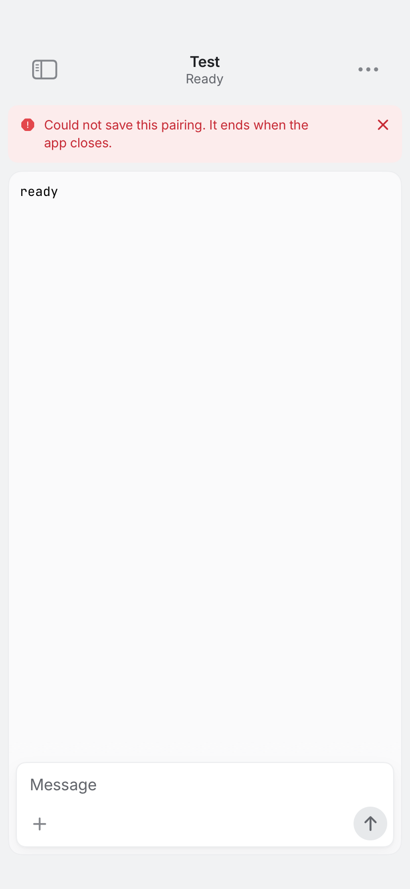
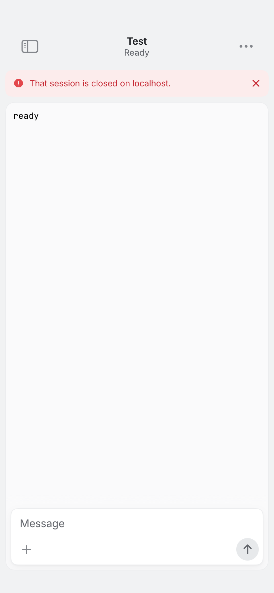

# REA-1200: notification navigation through store attachment

Base: `70d7923605ae3cb4e8dc512f12f655fcaf0c419d`.

## Reproduction

[Baseline CI680](https://github.com/gl11tchy/sigil/actions/runs/40168511550)
tested head `c852477a962155f3a1138f8720afe9d6dd769f23` with unchanged production.
Actual checkout `6bb191ada62e437215b02edd23e16d3618a3db45` has the expected
base/head parents and identical tree `5b4ae571ff2971956db2b3b59f6440ffbbdc45fd`.

The generated native result records 46 cases, 45 passed and one expected failure:
opening a missing session after a complete authenticated state did not show its
closed-session message. The actual value was the retained fixture save warning,
“Could not save this pairing. It ends when the app closes.”, not the previously
anticipated nil. No customer Keychain behavior is inferred. Verify, the iPhone
typecheck and all 88 relay checks passed; the TextKit stage was not reached after
the native failure.

The original 828×1792 PNG was exported from the generated result with the existing
legacy xcresult data reader and visually inspected. It shows that retained
warning and no closed-session message. SHA256:
`858003512e75076340cbd860fd443b599c7e293fdec60f225d01e415eceaf26e`.
The header “Test” is the selected tab title; the fixture's relay address is
localhost.

## Implementation boundaries

The notification service already clears unsealed routing fields and stamps the
pairing ID after decrypting a valid alert. Its delegate's shared MainActor handler
now retains only the latest bounded attributed target before the store attaches.
Unattributed or malformed notification input cannot choose an arbitrary current
Mac. Existing internal/widget calls without a Mac ID bind the current Mac once.

Pending navigation uses the actual pairing identity, connection commandEpoch and
authenticated tab snapshot. Cached rows and capped/partial lists cannot prove
closure. A cold intent may await its first authenticated connection to the same
Mac; a bound intent cannot cross epochs. New valid intent, Mac switch, forget or
manual selection cancels the older target. No intent is persisted.

Positive presence can select the current row; complete absence shows the named
closed-session message and consumes the target. Navigation waits for a busy send
without interleaving commands or acknowledging later send uncertainty. Existing
request serialization, command ownership, cryptography and pairing persistence
are unchanged. Demo resolution uses its explicit seeded list without a network.

## Implementation validation

[CI681](https://github.com/gl11tchy/sigil/actions/runs/40170666250) passed at
initial implementation head `697b66493231c1d33f4b35186bb2f5f36595bcb2`.
Actual checkout `ddea83c5dd30cb6fa7fac2b7a13169ba89626066` has the expected
base/head parents and identical tree `90523ff69001b0fe3eca626a8eb25d11242b349b`.
The generated native result records **all 55 cases successful**, with no failures.
Generated native cases cover
the cold handler-before-attach path, latest target/Mac attribution, unknown Mac,
partial/complete state, later ID appearance, epoch replacement, Mac switch,
offline/cache waiting, manual selection, busy success/refusal and demo behavior.
The baseline asynchronous assertion finding is addressed by retaining assertions
and repeating after layout, busy settling and an explicit authenticated state
roundtrip. The full gate also passed: 1,372 Swift tests in 114 suites, 37 Mac
XCTest cases, 318 Node tests, 58 Site tests, 260 browser cases, iPhone typecheck,
88 relay checks, native app/extensions/simulator and seven TextKit checks.
Two existing browser cases and four REA-1350 pointer fixtures were skipped;
the latter lack event-posting permission (two other sidebar fixtures passed).

Source review traced the new Demo branch's Live Activity helper to a possible
`Activity.request` for a working fixture. The final correction removes that
new Demo-only call and extends its existing test through the working row.
It changes no authenticated/closed-session path. This evidence commit includes
that source/test correction and the original PNGs below; it is not docs-only.
**Required exact-final-head CI remains pending before merge.**

## Inspected simulator captures

Both original 828×1792 PNGs were exported from generated NativeFlow attachments
and visually inspected. No pixels were changed. The before capture belongs to
CI680; the accepted after capture belongs to CI681/source697b664. The real closed
message path is unchanged by the final Demo-only correction, and final CI must
re-execute the complete suite at the final head.

Before: the retained fixture save warning does not explain the missing session.

SHA256: `858003512e75076340cbd860fd443b599c7e293fdec60f225d01e415eceaf26e`.

After: the closed-session message names localhost and remains after UI layout
and an authenticated state roundtrip. The same test then verifies that a later
appearance of the old ID cannot reactivate the consumed navigation intent.

SHA256: `584ebf159b4fbf7cfa85cd6bda6ca9a7ae62556ebb38e02e25879a250a7ff015`.

The cold fixture seeds only generated known pairings through the existing store
delegate because CI may refuse Keychain writes, then uses the real encrypted
connection and loopback relay. This tests the common delegate handler ordering,
not actual APNs/OS delivery or persistent Keychain restoration. Physical-device,
hosted relay deployment and running-app UX behavior remain unverified. No local
native execution/build/process enumeration or installed-app change occurred.
Parent personal review of exact final source/current comments must precede merge.
